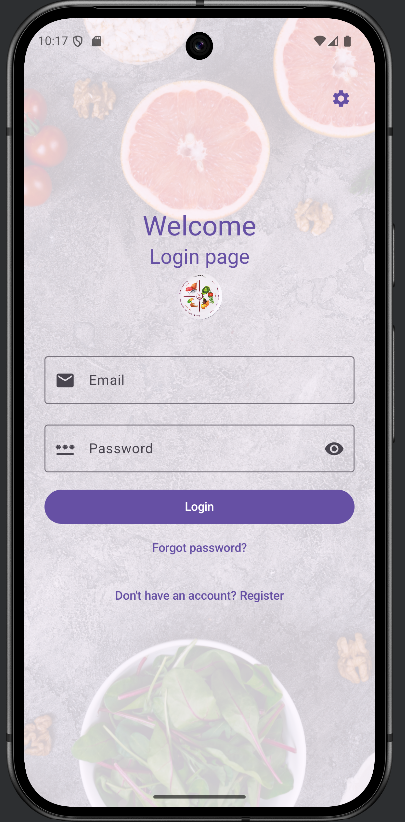

# Meal Tracker App

This is a mobile app for Android made with Android Studio.
The application is a meal tracker for planning meals and tracking calories for each meal, making it easy to record nutritional values and data.

## Features

- **Authentication:** register, log in, log out, and reset a forgotten password via email, using Firebase Authentication

  

- **Food search:** search the USDA FoodData Central (FDC) database by name and view per-result nutrition summaries (calories, protein, fat, carbs)
- **Food details:** open a dialog with the full nutrient breakdown for any search result or saved food
- **My Foods:** save foods to a personal list scoped to logged-in user, with:
  - Sorting by name, calories, or protein (ascending/descending), persisted between sessions
  - Pagination (10 items per page)
  - Removal option with confirmation
- **Dark / light theme:** toggle from the home screen, the choice is persisted
- **Developer settings:** override the FDC API key at runtime (e.g. to swap in a personal key), reachable via cog icon on login, register, and home screens

## Tech stack

- **Language:** Kotlin
- **UI:** Jetpack Compose with Material 3
- **Architecture:** MVVM (Compose UI ← `ViewModel` + `StateFlow` ← repositories / data sources)
- **Navigation:** Jetpack Navigation Compose (single-activity)
- **Local persistence:** Room (SQLite) + `SharedPreferences`
- **Networking:** Retrofit + OkHttp + Gson against FDC REST API
- **Auth:** Firebase Authentication
- **Build:** Gradle (Kotlin DSL) with KSP for Room codegen
- **SDK:** `minSdk 26`, `compileSdk`/`targetSdk 36`

### Data model

Room holds three tables with a many-to-many relationship between users and foods:

- `users` (`UserEntity`): identified by Firebase UID.
- `foods` (`FoodEntity`): identified by the FDC food id; stores description, brand, and core macros (calories, protein, fat, carbs).
- `user_food_cross_ref` (`UserFoodCrossRef`): join table connecting a user to the foods they have saved.

`UserWithFoods` is a Room relation that resolves a user together with their saved foods through the join table.

## Local setup

- Contact one of the repository owners to be added to the associated Firebase project
- Download `google-services.json` from Firebase, place under `/app`
- Obtain SHA-1 key from Android Studio and add it to Firebase Console
- **(Optional but recommended)** set up FDC API key obtained per [FDC API Documentation](https://fdc.nal.usda.gov/api-guide)
  - Add `FDC_API_KEY` property under `local.properties` at project top level
  - Alternatively, API key can be set from within app via Developer Settings menu (cog on top right of screen)
  - If not set, the placeholder `DEMO_KEY` will be used internally, which will work without prior signup but has much more aggressive date limiting compared to an API key obtained via signup (30 requests per IP per hour and 50 per day)
- From Android Studio, set build variant as `prodDebug` for local use
- Run app via Android Studio. The app was tested with the `Pixel 9 API 36.0` device emulated.